# Mission 1: the opening (minutes 0 to 5)

The opening raid on Greenest Fields, as a designed sequence: a short briefing, a staged objective,
each control learned by needing it, and the first five minutes paced so tension and relief take
turns and minute five ends on a hook. Issue #7.

## Where it lives

| What | Where |
|---|---|
| The script and its one pacing table | `data/escalation/mission1_opening.json` (`pacing`, explained key by key in `pacingNotes`) |
| The hub half: briefing, card words, the beats | `tools/verdance/campaign/opening.py`, called from `materialize_next_intent` for the sortie the script's `appliesTo` names (mission 1 of a fresh campaign, Greenest Fields, pad `GF_NW_MUSTER`, target `GF_NW_BASTION`), whether the order is the authored opening or the hub's own deploy stamp of it (the stamp does not carry the `openingMission` flag) |
| The gadget half: runs the beats, nothing else | `mod/VerdanceAshes.sdd/luarules/gadgets/include/campaign/beats.lua` |
| The facts the beats wait on | the campaign gadget's call-ins (`UnitCommand`, `UnitDamaged`, `UnitDestroyed`, `UnitCreated`, `AllowFeatureBuildStep`) and one UI message (`vabeatfact selected`, from `gui_verdance_field_marks.lua`; selection is unsynced) |
| What the player sees | `gui_verdance_infil.lua` (the card), `gui_verdance_sidebar.lua` (the rail and the route), `va_board.lua` (the board and minimap), `gui_verdance_field_marks.lua` (rings on the ground), `gui_verdance_voice.lua` (lines and prompts) |
| Tests | `tests/test_mission1_opening.py`, and `tools/hud_harness/opening_beats_test.py` (the beats in real Lua) |
| Screens | `tools/hud_harness/opening_render.py` writes `docs/screens/mission1_opening/` |

The file sits in `data/escalation/` because that folder ships with the game. A new `data/` folder
would also need a line in `scripts/ship.ps1`.

## The rules the opening keeps

- **Nothing is told that can be found by doing it.** No line explains a control unless the player
  has stalled on it. A prompt names the control, in Ketha's voice, and goes away the moment the
  player does the thing.
- **Shape and place first, words second.** The first goal is a gold double ring on the ground, a
  gold hollow diamond (◇) on the board and the minimap, the route line, and one line on the rail.
  A wreck worth a builder gets a blue dashed ring. The company is ringed until it is selected.
- **Prompts look different from story.** A prompt has the pad's blue accent and a border; a story
  line has neither. An enemy's voice has the orange accent.
- **The enemy answers the player.** Our first hit calls the farm's help; a company that sits still
  gets visited; the commander's presence is noticed and a column is sent.
- **The hub decides, the gadget executes.** Every time, distance and line is in the JSON; the
  gadget only watches facts and runs actions.

## The beat sheet

0:00 is the moment the company is on the field and the game runs (`op_land`). The "target" column
is a typical first-time player; the timers in brackets are what happens to a player who stalls.
Every timer is a key in `pacing`.

| # | Target time | Beat | Trigger | On screen | The player learns | The player feels |
|---|---|---|---|---|---|---|
| 0 | paused, before 0:00 | the card, `op_stage_first` | `sortie_start` (GameStart, before the first frame) | Ketha's three lines, 34 words: Armada spent its last Tenebrium on decoys; one of those farms is next door; break it, carry home what it drops, everyone who lands lifts. THE JOB · FIRST: "Off the pad. Eyes on their farm." The board shows the pad and the first goal ◇; the objective is not shown yet. "Paused until you press Pause." | the stakes, as one picture | curious; one small, clear task |
| 1 | 0:00 | `op_land` | `company_landed` (units on the field, no hot drop pending) | the company ringed in gold on the pad; the gold ring a little way out, toward the nearest farm; the route line pad → ring; the rail says only the first goal | — | calm |
| 2 | 0:00–0:10 [prompt at +`selectPromptSeconds`] | `op_selected`, `op_select_prompt` | `player_selected` (the UI reports a selection; any order counts too) | the company's rings go when it is selected. Stalled: "We're on the pad, waiting on your word. Drag a box round us." | **select** | agency |
| 3 | 0:05–0:20 [prompt at selection + `movePromptSeconds`] | `op_moved`, `op_move_prompt` | `player_moved` (a move, fight or patrol order) | the units walk. Stalled: "See the gold ring? Right-click inside it. We'll walk." | **move** | momentum |
| 4 | 0:30–0:50 [fallback at +`revealFallbackSeconds`] | `op_reveal` | a unit within `goalRingRadius` of the ring, or the fallback timer | the ring goes; the rail becomes "◆ Take the Northwest Bastion: break the farm, then hold the ground." with its gauges; the board and minimap show ◆ on the farm (the mark moves from the zone's box centre to the claimed targets); the route repaints ring → farm; a beep; Ketha: "There's the farm. Clear it, then hold the Bastion till it's ours." | the real job | tension rises: the farm is in sight |
| 5 | 0:50–1:20 [prompt at reveal + `attackPromptSeconds`] | `op_attacked`, `op_attack_prompt` | `player_attacked` (our first hit on an enemy, an attack or fight order, or a kill) | combat. Stalled: "Pick one of their panels and right-click it. We'll do the rest." | **attack** | tension |
| 6 | first hit + `answerDelaySeconds` | `op_answer` | elapsed after `op_attacked` | 3 Pawns and a Mace come in from Armada's own edge, out of sight, fighting toward us. Ketha: "They've noticed. Something's coming to ask what we're doing." | the enemy answers what you do | tension peaks |
| 6b | reveal + `probeSeconds`, only if nothing was hit | `op_probe` | elapsed after `op_reveal`, cancelled by `player_attacked` | 2 Rovers come to the company. Ketha: "They got tired of waiting for us. Here they come." | sitting still is a choice too | tension for a passive player |
| 7 | 1:20–2:00 | `op_first_kill` | `enemy_killed` (our first kill of an enemy unit) | a blue dashed ring on the wreck, and a soft beep. No words. | wrecks are worth something (the ring says so) | relief begins |
| 8 | [kill + `buildPromptSeconds`] | `op_build_prompt` | elapsed after `op_first_kill`, cancelled by `player_built` | Stalled: "That wreck's still warm. Right-click it with a Zagreus." | **build** (reclaim or raise with the rez bots; a build order counts too) | — |
| 9 | 1:40–2:30 | `op_built`, then `op_relief` (+`reliefLineDelaySeconds`), then `op_pavise` (+`paviseLineDelaySeconds`) | `player_built` after the kill (a builder working a wreck, or a build started) | the ring clears; metal comes in; Ketha: "That's metal we didn't have this morning." Then, if Pavise dropped: "I've got your left. Like before." | the loop: fight, wreck, haul | relief, warmth |
| 10 | 3:00–3:30 | `b3_midfight` (kept from the generic beats) | half the objective's targets down | Ketha's midfight line from her own pool | — | tension: the bill is being written |
| 11 | 3:30–4:30 | (the capture's hold) | the pocket cleared to the capture's fraction | the rail's gauge turns to "hold" | stand on it | relief: it is nearly ours |
| 12 | 4:45 (+`hookSeconds` after landing) | `op_hook`, then `op_hook_reply` (+`hookReplySeconds`) | elapsed after `op_land` | Armada's radio, intercepted, in orange: "Farm hit. Irregulars, and the deserter with them. Send a column." Ketha: "Deserter. He means you. Finish this before his column gets here." | they know who you are | the hook: a name, and a clock |
| 13 | hook + `columnSeconds` (about 7:15) | `op_column` | elapsed after `op_hook`, cancelled by `objective_complete` | 4 Pawns and 2 Maces. Ketha: "Column's here. Hold the farm or load the pad. Pick now." (If the farm was already taken, the gadget's own hot-extraction answer is the column.) | the extract choice | the hook pays off |

The rhythm, for the typical player: calm (0:00) → rising (0:45, the farm in sight) → peak (1:40, the
answer) → relief (2:20, the first haul) → rising (3:15, half done) → relief (4:00, the hold) → hook
(4:45). That is a turn about every 60 to 90 seconds.

The generic beats that stay: `b3_midfight`, `b4_wave`, `b5_run_home`, and the hero barks
`b6_hero_down` and `b7_hero_back`, which now wait `heroBarksNotBeforeSeconds` into the sortie. The
opening replaces `b1_move_out` (it told the player to build extractors) and `b2_contact` (the reveal
says it). Every other mission keeps all of its beats as before.

## Tuning

Everything below is in `pacing` in `data/escalation/mission1_opening.json`. Seconds unless it says elmos.

| Key | Default | What it does |
|---|---|---|
| `briefingMaxWords` | 60 | the most words on the card before control: the briefing, the first goal and the pause line (a test holds the script to it) |
| `selectPromptSeconds` | 12 | after landing, if nothing is selected: the select prompt |
| `movePromptSeconds` | 15 | after the first selection, if nobody was ordered to move: the move prompt |
| `revealFallbackSeconds` | 100 | after landing: the real job is revealed even if the ring was never reached |
| `attackPromptSeconds` | 25 | after the reveal, if nothing of theirs was hit: the attack prompt |
| `answerDelaySeconds` | 20 | after our first hit: the farm's answer arrives |
| `probeSeconds` | 120 | after the reveal, if we still hit nothing: they come to us |
| `buildPromptSeconds` | 25 | after our first kill, if no builder worked anything: the build prompt |
| `wreckMarkSeconds` | 60 | how long the ring on the first wreck stays |
| `reliefLineDelaySeconds` | 3 | after the first haul: Ketha's line |
| `paviseLineDelaySeconds` | 6 | after Ketha's relief line: Pavise's (only if Pavise dropped) |
| `hookSeconds` | 285 | after landing: the intercepted dispatch |
| `hookReplySeconds` | 4 | after the dispatch: Ketha's reply |
| `columnSeconds` | 150 | after the dispatch: the column, unless the farm is taken |
| `heroBarksNotBeforeSeconds` | 60 | the generic hero-down and hero-back barks stay quiet this long |
| `promptShowSeconds` | 9 | how long a prompt stays up if the player does not act (it clears when they do) |
| `lineShowSeconds` | 7 | how long a story line stays up |
| `dispatchShowSeconds` | 9 | how long the dispatch stays up |
| `goalRingRadius` | 300 | elmos: the first goal's ring, and how close counts as reaching it |
| `goalStopShort` | 700 | elmos: the ring sits this far short of the nearest farm, on the line from the pad |
| `goalMinFromPad` | 900 | elmos: and never nearer the pad than this; keep `goalMinFromPad` − `goalRingRadius` above 560 (the pad's radius) |
| `wreckRingRadius` | 110 | elmos: the ring on the first wreck |

The forces (`forces.answer`, `forces.probe`, `forces.column`) and every line (`briefing`, `card`,
`lines`) are in the same file. Lines stay under 66 characters so they fit the voice frame.

## The beat engine, for whoever writes the next opening

A beat is `{ id, trigger, afterBeat, notBefore, cancelIf, actions }`.

- `afterBeat` (an id or a list) arms the beat once those have fired; an `elapsed` trigger counts
  from the moment the last of them fired.
- `cancelIf` is a list of triggers; if any is met while the beat waits, the beat is dropped unfired.
- `notBefore` is seconds of game time before which the beat cannot fire.
- New triggers: `sortie_start`, `company_landed`, `elapsed`, `near_point`, `player_selected`,
  `player_moved`, `player_attacked`, `player_built`, `enemy_killed` (the facts take `atLeast`, and
  `fresh: true` counts only what happened after the beat's `afterBeat` fired), `any_of`, `all_of`.
- New actions: `objective_stage` (stage 1: a first goal with a ring; stage 2: the job's own words),
  `field_mark` / `clear_mark` (rings on the ground), `clear_bark` (take a tagged line down). A
  `bark` takes `priority` (`ambient` may be dropped when the voice stack is busy; `line` and
  `prompt` never are), `accent` (an Ash colour name), `tag`, and `onlyIfHero`.
- Points: `at = pad | objective | goal | last_kill | company | overlook`, a `zoneId`, or
  normalised `x`/`z`.
- `hero_down`, `hero_recovered` and `hero_lost` without a `heroId` now count only the company's
  own heroes. A field recruit lying in the field as a wreck is "down" from frame 2, and a bark
  about a stranger in the first second was wrong.

## Screens

Rendered from the widgets' own draw calls by `tools/hud_harness/opening_render.py`, with the
gadget's `beats.lua` running the beats the hub writes. Not BAR: no terrain, no models. The field is
a top-down schematic (our units green, Armada's blue, wrecks ✚), with the rings and the route where
BAR draws them on the ground.

| | |
|---|---|
| 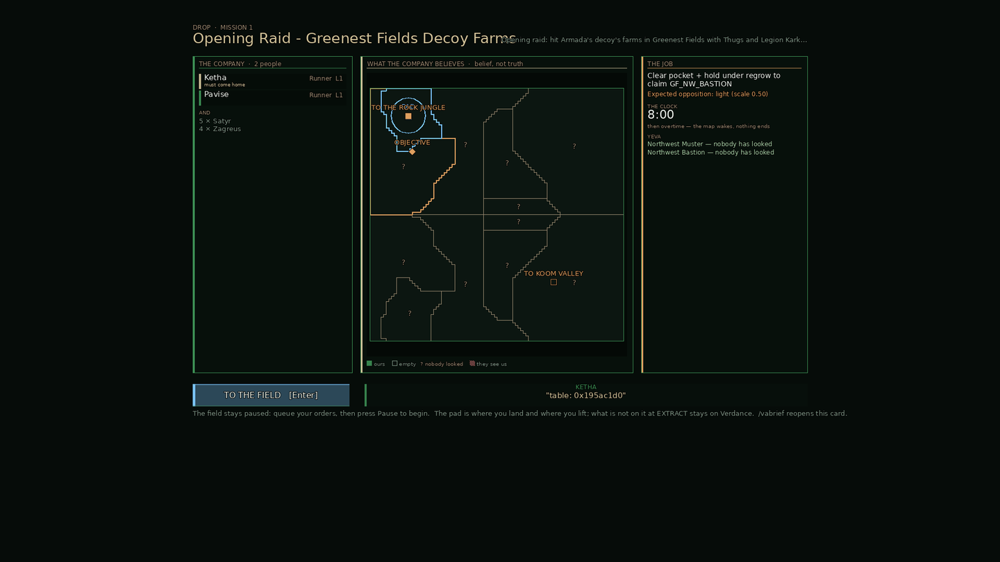 the card before (master): the briefing line printed as a Lua table address | 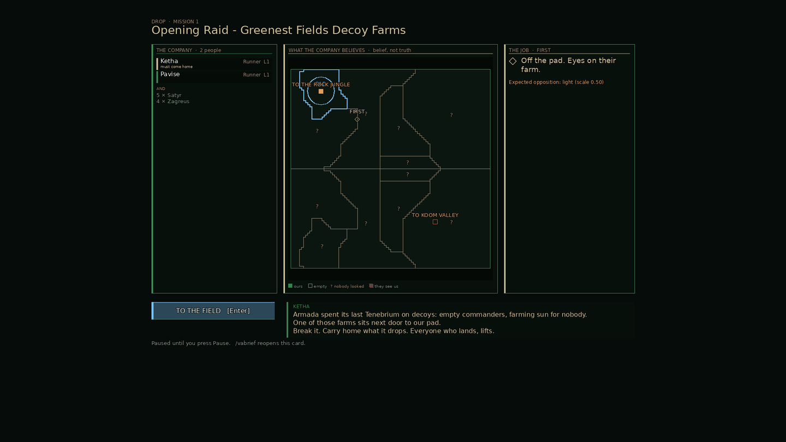 the card after |
| 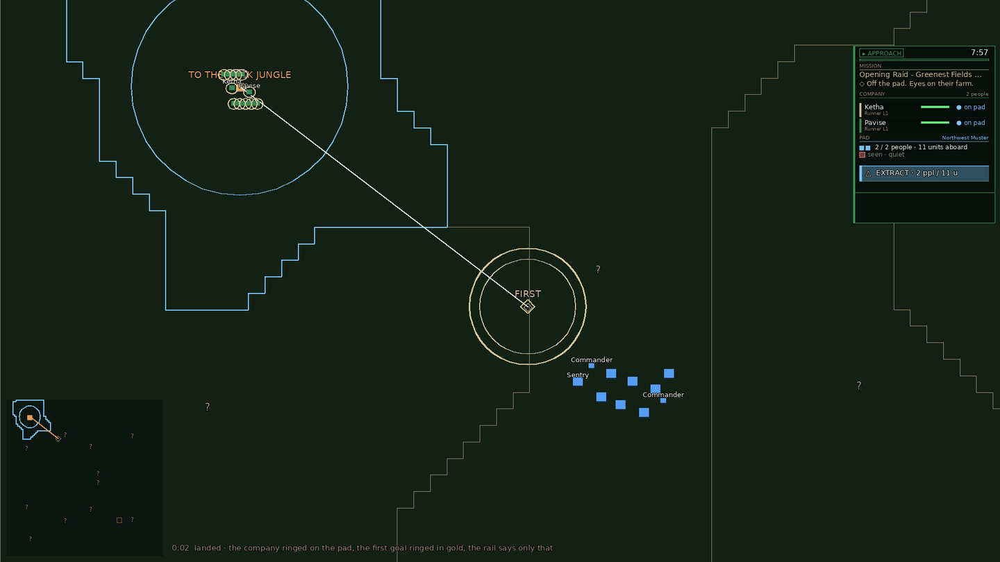 0:02 landed | 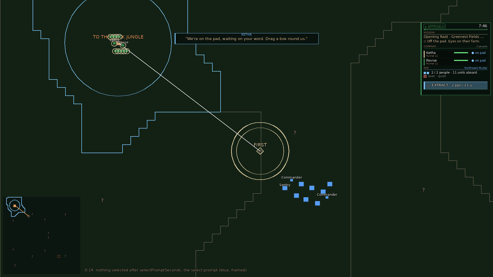 0:14 select prompt |
| 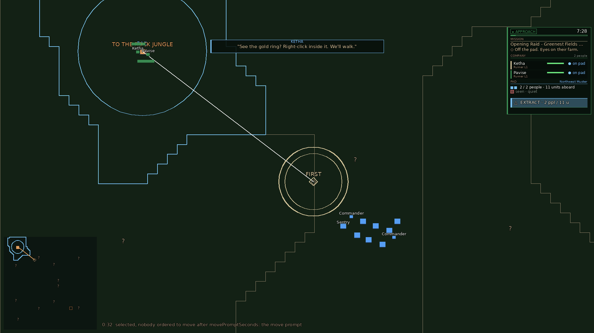 0:32 move prompt | 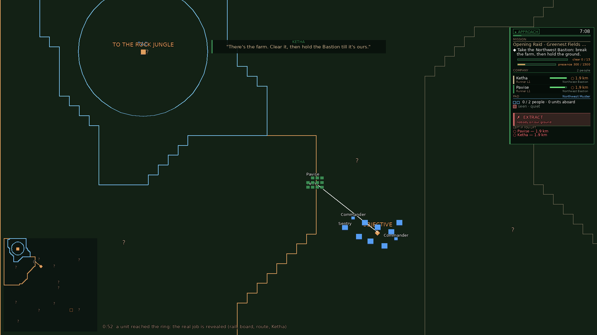 0:52 the job revealed |
| 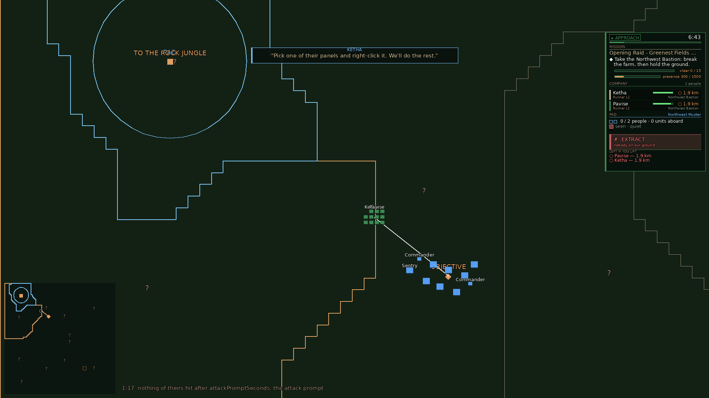 1:17 attack prompt | 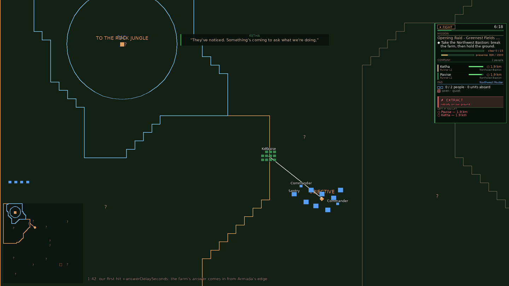 1:42 the farm answers |
| 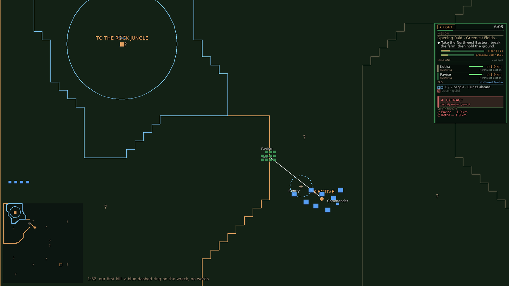 1:52 first kill, the wreck ringed | 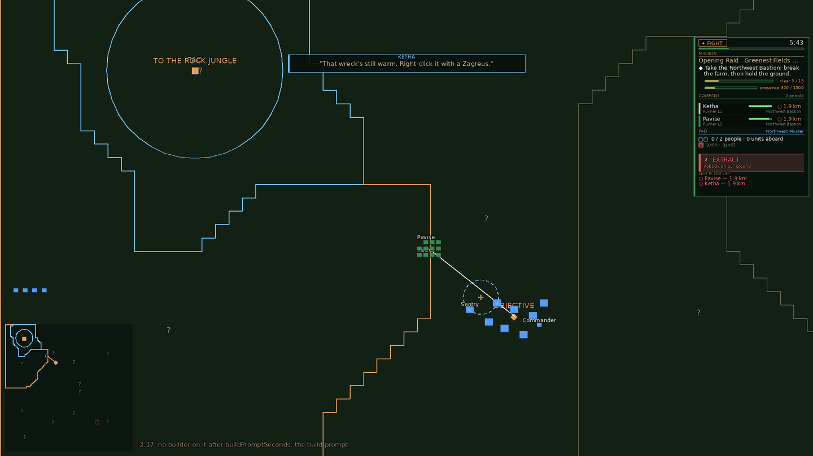 2:17 build prompt |
| 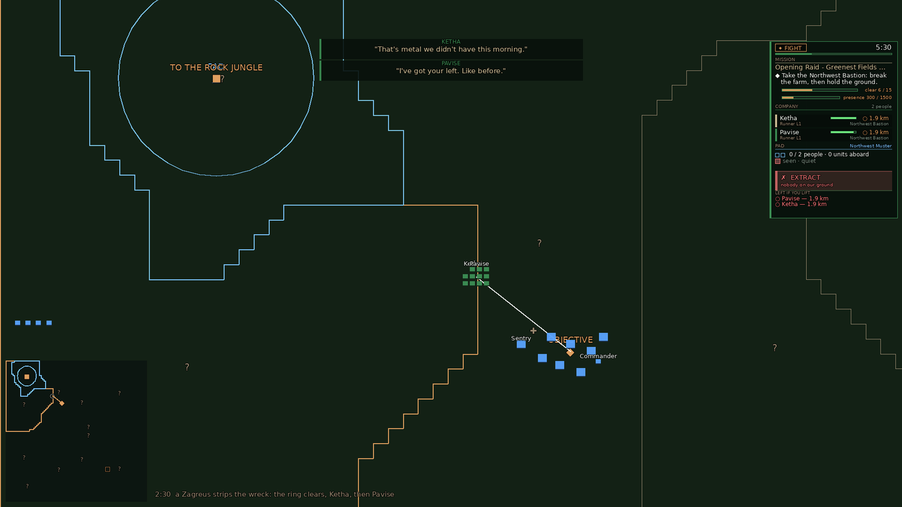 2:30 the first haul | 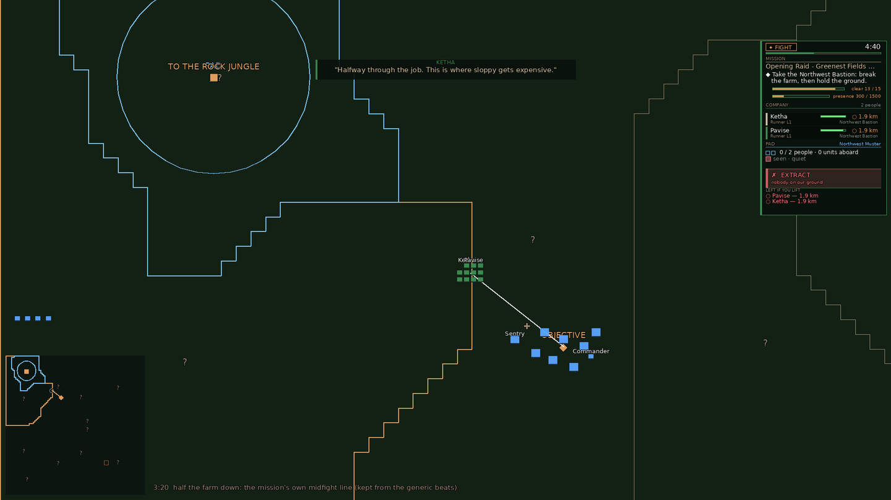 3:20 midfight |
| 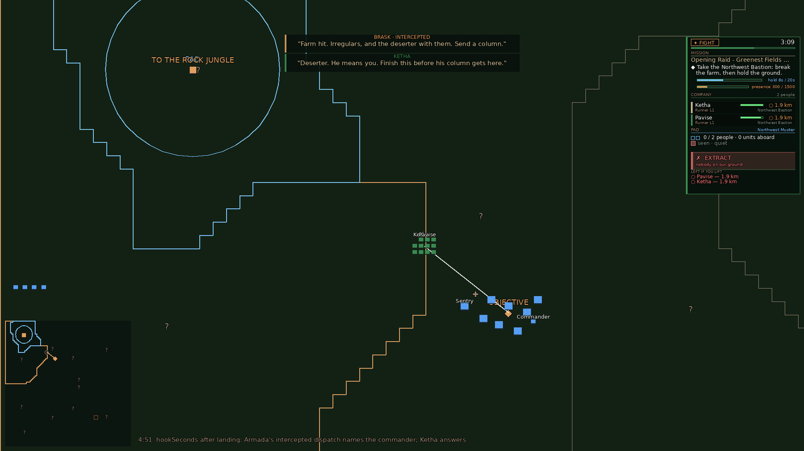 4:51 the hook | |

The screens play a player who stalls on every control once, so that every prompt shows. A player
who does each thing in time sees none of them (`opening_beats_test.py`, the "quick" player).
